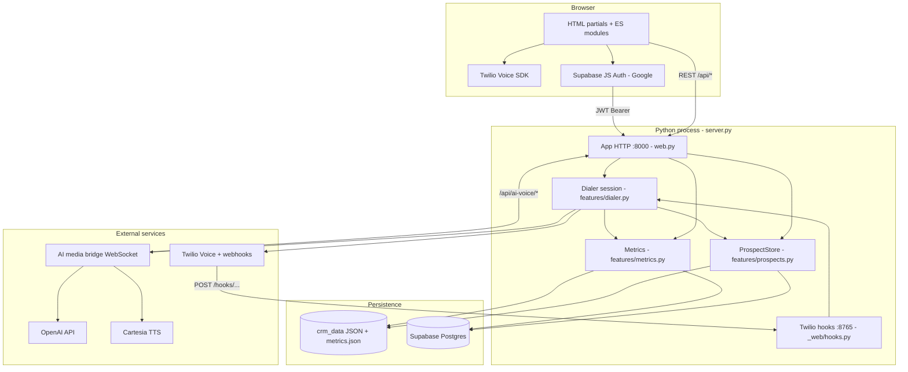

# 2. System map

## High-level diagram

## Connection summary

| From | To | Protocol | Purpose |
|------|-----|----------|---------|
| Browser | `127.0.0.1:8000` | HTTP | SPA shell, static files, JSON API |
| Browser | Twilio | WebRTC + token from `/api/voice-token` | Human agent microphone/earpiece |
| Browser | Supabase Auth | HTTPS | Google OAuth; access token sent as `Authorization: Bearer` |
| Twilio | `127.0.0.1:8765` (exposed as HTTPS via `PUBLIC_BASE_URL`) | HTTP POST | Call status, TwiML, AMD, transcripts |
| AI bridge (optional) | App | HTTP + WebSocket | Stream audio; callbacks on `/api/ai-voice/*` |
| Python server | Supabase | HTTPS REST + RPC | CRUD on `prospects`, metrics, settings |
| Python server | OpenAI / Cartesia | HTTPS | AI agent replies and TTS (when configured) |

## Two HTTP servers in one process

`server.serve()` starts:

1. **App server** — `APP_HOST`/`APP_PORT` (default `127.0.0.1:8000`) — `web.make_app_handler`
2. **Hook server** — `HOOK_HOST`/`HOOK_PORT` (default `127.0.0.1:8765`) — `_web.hooks.make_hook_handler`

Twilio must reach the **hook** port on a **public HTTPS URL** (`PUBLIC_BASE_URL`), while reps use the **app** port locally or behind the same tunnel.