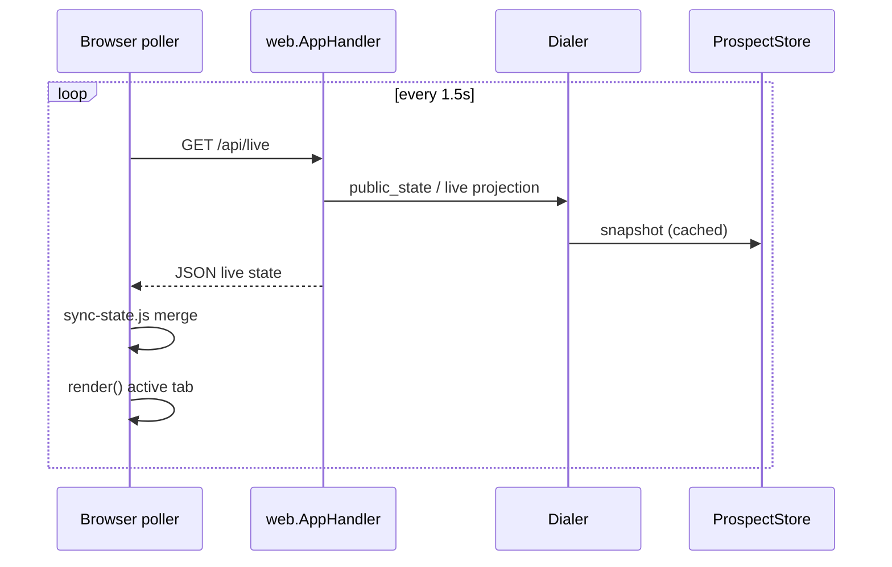
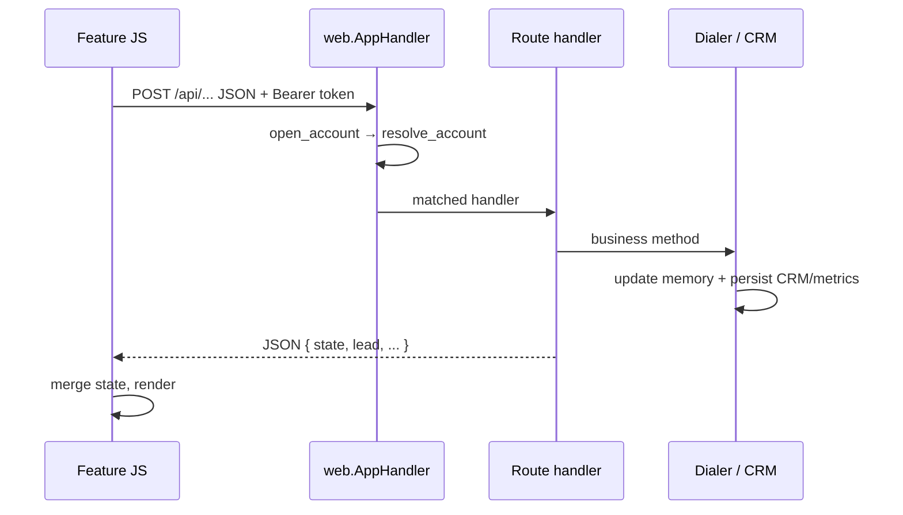
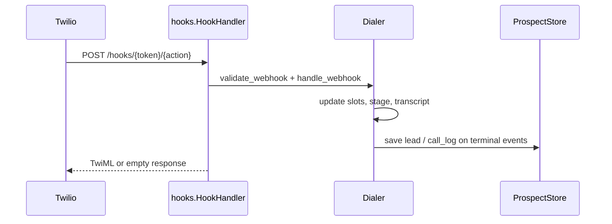

# 7. Information flow

## Generic read path (UI refresh)

When `leads_version` in live payload changes, poller also fetches `GET /api/leads` for full table rows.

## Generic write path (user action)

`POST` handlers live in `features/*.py`; `web.AppHandler.do_POST` dispatches based on `match_route` and passes parsed JSON.

## Static assets

`GET /main.js`, `/css/*.css` → `HandlerMixin.serve_static` in `_web/respond.py` with MIME types; no auth.

## Twilio callback path

Desk token in URL or `DeskToken` query ties callback to the correct `Dialer` instance (`TokenIndex`).

## CSV import flow

1. UI `POST /api/import` multipart or raw CSV body.
2. `prospects.post_import` → `ProspectStore.add_csv`.
3. Parse via `features/_prospects/csv_import.py`; bump `leads_version`.
4. Optional `post_scan` maintenance via explicit scan endpoint—not automatic on GET.